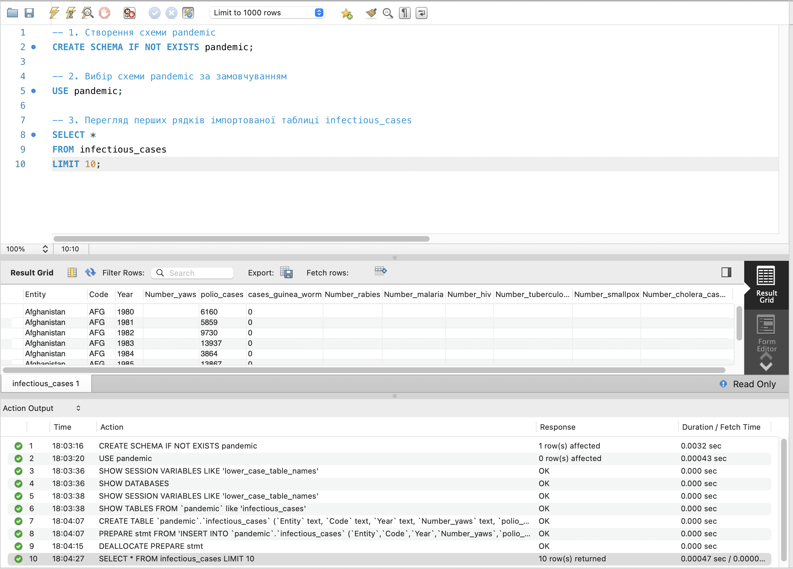
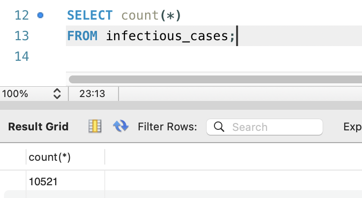
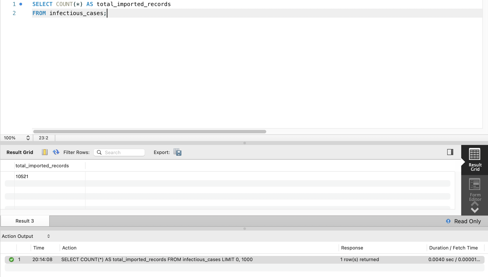
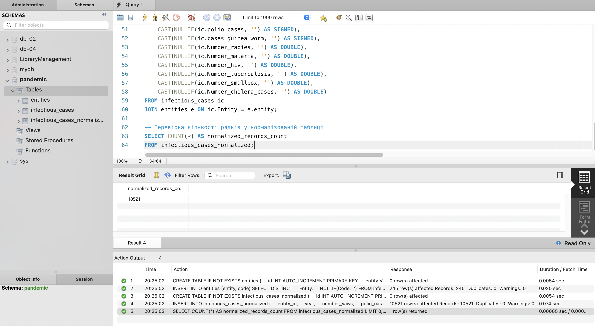
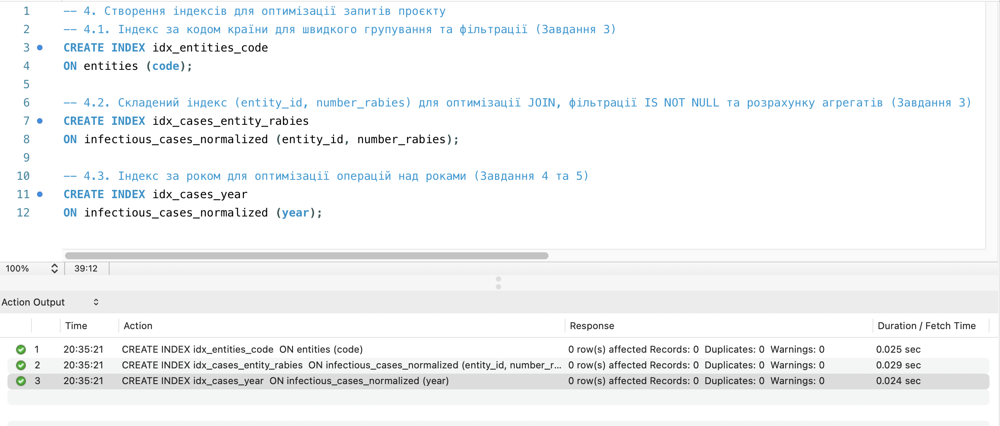
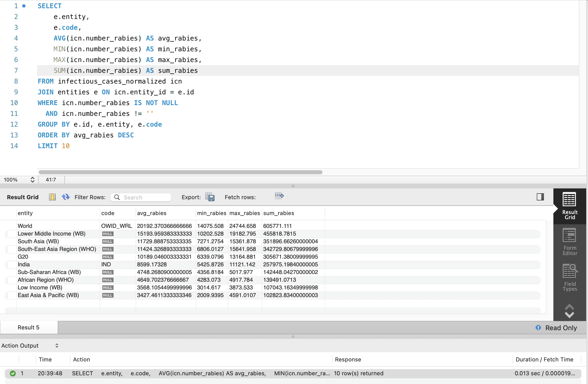
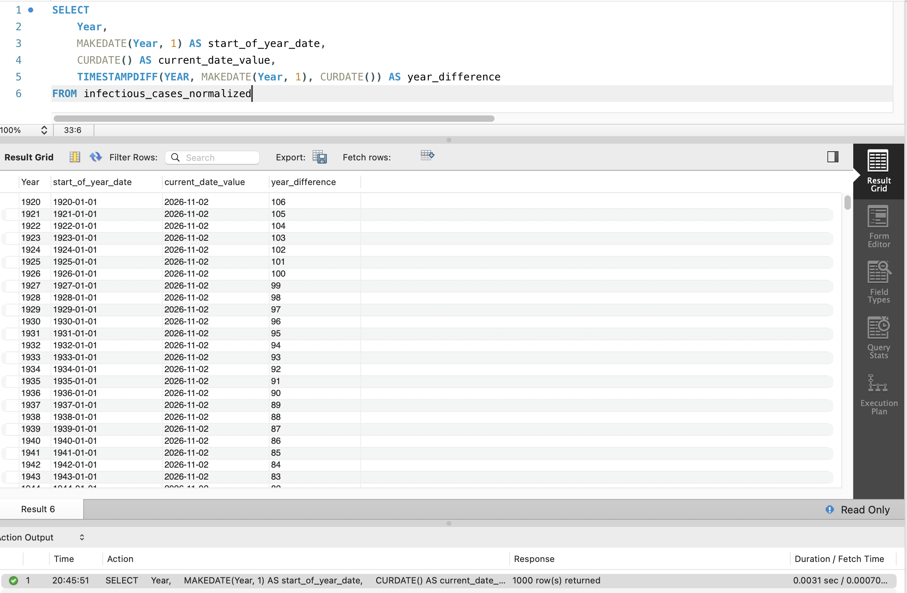
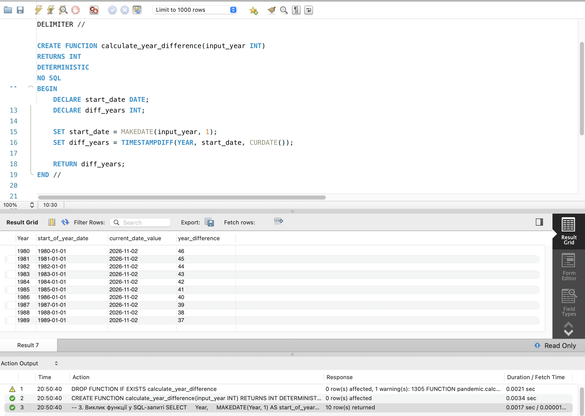

# GoIT RDB Final Project

Цей репозиторій містить результати виконання фінального проєкту з курсу Реляційних Баз Даних (GoIT).

---

## Завдання 1

1. Створіть схему `pandemic` у базі даних за допомогою SQL-команди.
2. Оберіть її як схему за замовчуванням за допомогою SQL-команди.
3. Імпортуйте дані за допомогою Import wizard з `infectious_cases.csv`.
4. Продивіться дані, щоб бути у контексті.

```sql
-- 1. Створення схеми pandemic
CREATE SCHEMA IF NOT EXISTS pandemic;

-- 2. Вибір схеми pandemic за замовчуванням
USE pandemic;

-- 3. Перегляд перших рядків імпортованої таблиці infectious_cases та загальної кількості записів
SELECT *
FROM infectious_cases
LIMIT 10;

SELECT count(*) AS total_records
FROM infectious_cases;
```

**Скріншот результату:**



---

## Завдання 2

Нормалізуйте таблицю `infectious_cases` до 3-ї нормальної форми (3NF). Збережіть у цій же схемі дві таблиці з нормалізованими даними:

- Таблицю-довідник для сутностей `entities` (з атрибутами `id`, `entity`, `code`);
- Нормалізовану таблицю показників `infectious_cases_normalized` (з зовнішнім ключем `entity_id` на таблицю `entities`).

Також виконайте запит `SELECT COUNT(*) FROM infectious_cases`.

### Теоретичне обґрунтування нормалізації до 3NF

1. **1NF**: Таблиця перебуває в 1NF, оскільки всі стовпчики містять атомарні значення, рядки унікальні.
2. **2NF**: У вихідній таблиці атрибути `Entity` та `Code` дублюються для кожного року, утворюючи надлишковість. При створенні первинного ключа `Code` функціонально залежить від `Entity`.
3. **3NF**: Відокремлення атрибутів `Entity` та `Code` у самостійну таблицю `entities` усуває транзитивні та часткові функціональні залежності. Таблиця спостережень посилається на `entities(id)` за допомогою зовнішнього ключа (`FOREIGN KEY`), усуваючи аномалії модифікації, видалення та вставки.

> **Особливість конвертації даних:**
> Оскільки Import Wizard імпортував усі колонки з типом `text`, порожні значення у файлі збереглися як порожні рядки `''`. При перенесенні даних у нормалізовану таблицю використовується комбінація:
>
> - `NULLIF(column, '')` — перетворює порожні рядки на `NULL`;
> - `CAST(... AS DOUBLE)` / `CAST(... AS SIGNED)` — коректно приводить текстові дані до відповідних числових типів без помилок конвертації.

```sql
-- 1. Перевірка кількості записів, завантажених з CSV-файлу
SELECT COUNT(*) AS total_imported_records
FROM infectious_cases;

-- 2. Створення таблиці-довідника entities
CREATE TABLE IF NOT EXISTS entities (
    id INT AUTO_INCREMENT PRIMARY KEY,
    entity VARCHAR(255) NOT NULL,
    code VARCHAR(10) NULL,
    CONSTRAINT uq_entity UNIQUE (entity)
);

-- Заповнення таблиці entities унікальними комбінаціями Entity та Code
INSERT INTO entities (entity, code)
SELECT DISTINCT
    Entity,
    NULLIF(Code, '')
FROM infectious_cases;

-- 3. Створення нормалізованої таблиці infectious_cases_normalized
CREATE TABLE IF NOT EXISTS infectious_cases_normalized (
    id INT AUTO_INCREMENT PRIMARY KEY,
    entity_id INT NOT NULL,
    year INT NOT NULL,
    number_yaws INT NULL,
    polio_cases INT NULL,
    cases_guinea_worm INT NULL,
    number_rabies DOUBLE NULL,
    number_malaria DOUBLE NULL,
    number_hiv DOUBLE NULL,
    number_tuberculosis DOUBLE NULL,
    number_smallpox DOUBLE NULL,
    number_cholera_cases DOUBLE NULL,
    FOREIGN KEY (entity_id) REFERENCES entities(id) ON DELETE CASCADE
);

-- Наповнення нормалізованої таблиці даними з конвертацією типів
INSERT INTO infectious_cases_normalized (
    entity_id,
    year,
    number_yaws,
    polio_cases,
    cases_guinea_worm,
    number_rabies,
    number_malaria,
    number_hiv,
    number_tuberculosis,
    number_smallpox,
    number_cholera_cases
)
SELECT
    e.id AS entity_id,
    CAST(NULLIF(ic.Year, '') AS SIGNED) AS year,
    CAST(NULLIF(ic.Number_yaws, '') AS SIGNED),
    CAST(NULLIF(ic.polio_cases, '') AS SIGNED),
    CAST(NULLIF(ic.cases_guinea_worm, '') AS SIGNED),
    CAST(NULLIF(ic.Number_rabies, '') AS DOUBLE),
    CAST(NULLIF(ic.Number_malaria, '') AS DOUBLE),
    CAST(NULLIF(ic.Number_hiv, '') AS DOUBLE),
    CAST(NULLIF(ic.Number_tuberculosis, '') AS DOUBLE),
    CAST(NULLIF(ic.Number_smallpox, '') AS DOUBLE),
    CAST(NULLIF(ic.Number_cholera_cases, '') AS DOUBLE)
FROM infectious_cases ic
JOIN entities e ON ic.Entity = e.entity;

-- Перевірка кількості рядків у нормалізованій таблиці
SELECT COUNT(*) AS normalized_records_count
FROM infectious_cases_normalized;

-- 4. Створення індексів для оптимізації запитів проєкту
-- 4.1. Індекс за кодом країни для швидкого групування та фільтрації (Завдання 3)
CREATE INDEX idx_entities_code 
ON entities (code);

-- 4.2. Складений індекс (entity_id, number_rabies) для оптимізації JOIN, фільтрації IS NOT NULL та розрахунку агрегатів (Завдання 3)
CREATE INDEX idx_cases_entity_rabies 
ON infectious_cases_normalized (entity_id, number_rabies);

-- 4.3. Індекс за роком для оптимізації операцій над роками (Завдання 4 та 5)
CREATE INDEX idx_cases_year 
ON infectious_cases_normalized (year);
```

### Оптимізація індексами:

- **`uq_entity`**: унікальний індекс на `entities(entity)` (створений через `UNIQUE CONSTRAINT`), забезпечує миттєвий пошук сутності та швидке з'єднання `JOIN` під час міграції та вибірок.
- **`idx_entities_code`**: пришвидшує групування `GROUP BY e.id, e.entity, e.code` у Завданні 3.
- **`idx_cases_entity_rabies`**: композитний індекс, який покриває умову з'єднання `JOIN`, фільтрацію `WHERE number_rabies IS NOT NULL` та розрахунок агрегатів (`AVG`, `MIN`, `MAX`, `SUM`) за принципом Covering Index.
- **`idx_cases_year`**: пришвидшує вибірку, фільтрацію та обчислення функцій над колонкою `year` у Завданнях 4 та 5.

**Скріншот результату:**




---

## Завдання 3

Для кожної унікальної комбінації `Entity` та `Code` (або їх `id`) порахуйте середнє (`AVG`), мінімальне (`MIN`), максимальне (`MAX`) значення та суму (`SUM`) для атрибута `Number_rabies`.

- Відфільтруйте порожні значення `Number_rabies` (`!= ''` та `IS NOT NULL`).
- Результат відсортуйте за порахованим середнім значенням у порядку спадання.
- Оберіть тільки 10 рядків для виведення на екран.

```sql
-- Запит на основі нормалізованих таблиць
SELECT
    e.entity,
    e.code,
    AVG(icn.number_rabies) AS avg_rabies,
    MIN(icn.number_rabies) AS min_rabies,
    MAX(icn.number_rabies) AS max_rabies,
    SUM(icn.number_rabies) AS sum_rabies
FROM infectious_cases_normalized icn
JOIN entities e ON icn.entity_id = e.id
WHERE icn.number_rabies IS NOT NULL
  AND icn.number_rabies != ''
GROUP BY e.id, e.entity, e.code
ORDER BY avg_rabies DESC
LIMIT 10;
```

**Скріншот результату:**


---

## Завдання 4

Для оригінальної або нормованої таблиці для колонки `Year` побудуйте з використанням вбудованих SQL-функцій:

- атрибут, що створює дату першого січня відповідного року (наприклад, `'1996'` → `'1996-01-01'`);
- атрибут, що дорівнює поточній даті (`CURDATE()`);
- атрибут, що дорівнює різниці в роках двох вищезгаданих колонок (`TIMESTAMPDIFF(YEAR, ...)`).

```sql
SELECT
    Year,
    MAKEDATE(Year, 1) AS start_of_year_date,
    CURDATE() AS current_date_value,
    TIMESTAMPDIFF(YEAR, MAKEDATE(Year, 1), CURDATE()) AS year_difference
FROM infectious_cases_normalized;
```

**Скріншот результату:**


---

## Завдання 5

Створіть і використайте власну функцію, що будує такий же атрибут, як і в завданні 4: функція приймає на вхід значення року (INT), а повертає різницю в роках між поточною датою та датою, створеною з атрибута року (1996 рік → `1996-01-01`).

```sql
-- 1. Видалення функції, якщо вона вже існує
DROP FUNCTION IF EXISTS calculate_year_difference;

-- 2. Створення функції calculate_year_difference
DELIMITER //

CREATE FUNCTION calculate_year_difference(input_year INT)
RETURNS INT
DETERMINISTIC
NO SQL
BEGIN
    DECLARE start_date DATE;
    DECLARE diff_years INT;

    SET start_date = MAKEDATE(input_year, 1);
    SET diff_years = TIMESTAMPDIFF(YEAR, start_date, CURDATE());

    RETURN diff_years;
END //

DELIMITER ;

-- 3. Виклик функції у SQL-запиті
SELECT
    Year,
    MAKEDATE(Year, 1) AS start_of_year_date,
    CURDATE() AS current_date_value,
    calculate_year_difference(Year) AS year_difference
FROM infectious_cases
LIMIT 10;
```

**Скріншот результату:**

